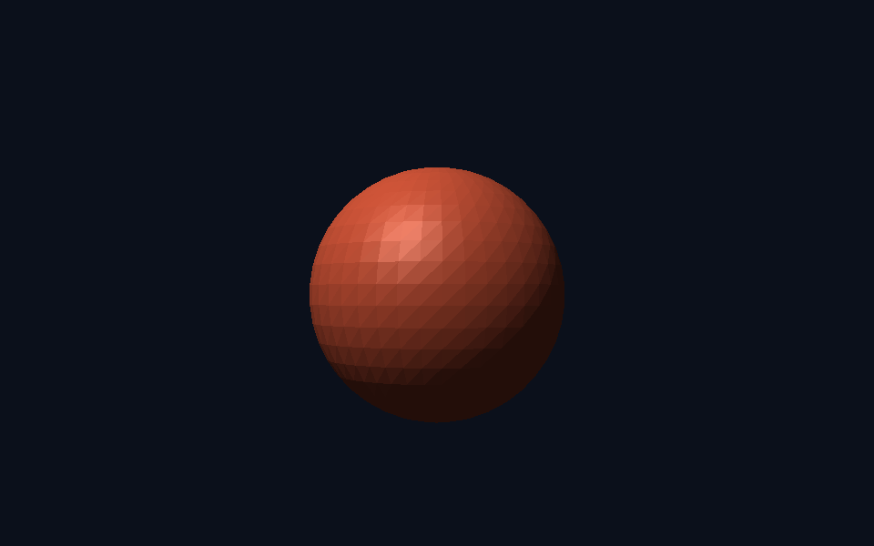

# WebAssembly target

`--backend wasm` compiles a subset of Anvil to a WebAssembly module and writes a
host page beside it. Console programs run under Node and browser pages render 2D
and selected 3D scenes to a `<canvas>`. The browser host also provides input,
audio, IndexedDB-backed saves and WebGL for the documented feature subset.

```sh
python compiler/anvil.py hello.ANVL --backend wasm -o hello.wasm
node tools/wasm_host.mjs hello.wasm
# or: python compiler/anvil.py hello.ANVL --backend wasm --run
```

The build writes `hello.wasm` and `hello.html`. Browsers refuse `fetch()` from
`file://` URLs, so serve the folder over HTTP:

```sh
python -m http.server 8000
# then open http://localhost:8000/hello.html
```

## What runs

The generated C is the same code the C backend emits; only the runtime differs.
`runtime/anvil_wasm.c` is a freestanding runtime (no libc, no libm, no OS) whose
host dependencies are imports in `env`:

```c
void write(int fd, const void *bytes, int length);
void clear(int r, int g, int b, int a);
void rect(double x, double y, double w, double h, int r, int g, int b, int a);
void circle(double x, double y, double radius, int r, int g, int b, int a);
void line(double x1, double y1, double x2, double y2, double thickness,
          int r, int g, int b, int a);
void text(double x, double y, const char *text, int length,
          int r, int g, int b, int a);
void present(void);
```

The browser page also provides `sphere_impostor_available()` and
`sphere_impostor(...)` for the WebGL `ray_sphere` shader path. When WebGL or
`EXT_frag_depth` is unavailable, the runtime keeps its triangle tessellation
fallback; Node and painter mode always use that fallback.

`anvil_run` stores the callbacks and returns; the host drives frames by calling
the exported `anvil_frame(delta_ms)`, which runs one update, clears with the
scene colour, draws and calls `present`.

The freestanding runtime provides `printf`/`putchar`, number formatting, string
helpers, arrays and a 1 MiB bump allocator. Browser resources are baked at build
time; arbitrary runtime file and network access are not exposed.

Supported today:

- numbers, arithmetic, comparisons, `and`/`or`/`not`
- globals, fixed arrays, functions with parameters and return values
- `if` / `else`, `while`, `for`
- `say`, `write`, `output`
- text values, `&` joining, and the builtins `len`, `mid`, `upper`, `lower`,
  `trim`, `left`, `right`, `char`, `contains`, `starts_with`, `ends_with`,
  `number`, `ord`, `chr`
- `noise` and `fbm` (same hash and gradient tables as the C runtime)
- `floor`, `ceil`, `sqrt`, `abs`, `min`, `max`, `clamp`, `round`
- `sin`, `cos` (range-reduced Taylor series, no libm), `tan` (nearest-pi/2
  double-double reduction for ordinary angles, reciprocal evaluation near
  poles; extremely large finite inputs retain the angle reducer's 1e20 limit),
  and `rnd` (xorshift64,
  inclusive integer range like the C runtime)
- `scene 2d` with `fn(draw)`, `clear`, and `display rect/circle/line/text`
- `scene 3d` with `camera perspective`, `camera fov`, `camera_angle`,
  `display cube/plane/sphere`, `model_draw` and lighting controls (glTF baked
  at build time)
- input and time: `time()`, `delta()`, `pressed(key)`, `held(key)`,
  `mouse_x()`, `mouse_y()`, `mouse_pressed(button)`, `mouse_held(button)`,
  `mouse_wheel()`
- images: `image_load`, `image_width`, `image_height`, `image_draw`,
  `image_draw_scaled`, `image_draw_rotated`, `image_tint`, `image_flip`,
  `image_destroy`, `image_error` (literal paths baked at build time)
- audio: `sound_load`, `sound_play`, `sound_play_loop`, `sound_stop`,
  `sound_stop_all`, `sound_volume`, `sound_pan`, `sound_pitch`,
  `sound_duration`, `sound_group`, `sound_group_volume`, `sound_group_mute`,
  `sound_group_gain`, `sound_group_stop`, `sound_active`, `sound_destroy`,
  `sound_error` (literal sound paths baked at build time; music uses a streamed
  WAV sidecar)
- music: `music_load`, `music_play`, `music_play_loop`, `music_stop`,
  `music_playing`, `music_volume`, `music_position`, `music_length`,
  `music_error` (one literal PCM WAV track streamed from a same-origin sidecar)
- physics: `body_create`, `body_create_box`, `body_destroy`, `body_active`,
  `body_x/y/vx/vy`, `body_set_velocity`, `body_force`, `body_restitution`,
  `body_friction`, `body_collision`, `physics_capacity`, `physics_gravity`,
  `physics_step`
- particles: `particle_emit`, `particle_count`, `particle_clear`,
  `particle_gravity` — the same 4,096-particle pool, fading squares drawn after
  the program's own pass
- accounting: `memory_images`, `memory_audio`, `memory_video`, `memory_total`
- saves: `save_number`, `load_number`, `save_text`, `load_text`,
  `save_exists`, `save_delete`, `save_error`

Refused with a source-located error:

- `engine` statements
- `display` shapes other than `rect`, `circle`, `line`, `text`, `cube`, `plane`,
  `sphere` and `ray_sphere` (sprites use the image API)
- any other builtin; the current refusals are `memory_report`,
  `frame_capture`, `text_width` and the `tilemap_*` family (the console, canvas, baked-asset,
  audio, save, physics, particle and accounting builtins listed above
  are supported)

For example:

```text
hello.ANVL:2: 'time' is not available in the wasm backend yet
```

## Input

The host page listens on the window and canvas and calls exported setters:

| Browser event | Export | Notes |
| --- | --- | --- |
| `keydown` / `keyup` | `anvil_key(code, down)` | `KeyA`–`KeyZ` map to `A`–`Z` (65–90); Space 32, Enter 13, Escape 27, arrows 37–40 |
| `mousemove` | `anvil_mouse(x, y)` | scaled from the canvas CSS size to its 960×600 buffer |
| `mousedown` / `mouseup` | `anvil_mouse_button(index, down)` | index 0 left, 1 right, 2 middle |
| `wheel` | `anvil_wheel(delta)` | `deltaY` |

`anvil_frame(delta_ms)` advances `time()` by the delta (clamped to 0–250 ms) and
sets `delta()` in seconds; pressed edges and wheel deltas last one frame, like
the C runtime's first-update clearing. `mouse_x()`/`mouse_y()` are `-1` until the
pointer first moves.

The page calls `anvil_input_release()` on `blur` and when the tab becomes
hidden. Without it a keyup delivered to another window is never seen, so the
module would keep the key held forever and the next press would not register as
a fresh press. The export clears held and pressed keys, mouse buttons and the
wheel delta; a test drives a real generated page through
`tools/wasm_page.mjs` and proves the release and re-press.

The page exposes `window.anvil` (the instance) so a console or test can step
frames and inject input deterministically:

```js
window.anvil.exports.anvil_key(65, 1);
window.anvil.exports.anvil_frame(16);
```

## 3D

`scene 3d` works with the same camera conventions as the C runtime: `camera
perspective x y z` sets the eye, `camera fov(degrees)` clamps to 20-120 and sets
the focal length from the 960-pixel width, `camera_angle(yaw,pitch)` turns the
view, and `display cube/plane/sphere` submit world-space triangles. Each
triangle is rotated, translated, put in camera space with the C runtime's basis,
projected, flat-shaded with the scene light and handed to the host. The
`light(x,y,z)` vector points toward the light; zero and non-finite vectors are
rejected, and valid vectors are normalized when shading. `light_ambient(level)`
sets the 0–1 floor (default 0.28), and `light_intensity(level)` sets the 0–2
scale for the lit part (default 1). Both setters return their previous value
and ignore non-finite input. Shading is `ambient + (1 - ambient) * intensity *
max(0, dot(normal, light))`, clamped to 0–1. Primitive triangles are one-sided;
imported model triangles are two-sided. `ray_sphere` keeps its fixed tracer light
and shading on both backends; the scene-light controls apply to primitives and
models.

Shadows are the same overhead projection as the desktop runtime: `shadow(on)`,
`shadow_height(y)` and `shadow_alpha(a)` flatten a cube's bottom face and every
model triangle onto the ground plane in black with that alpha. Shadow triangles
carry a separate draw layer so they paint after ordinary geometry; without it
the floor's own triangles sorted over them. The shadow quad uses the cube's
bottom face — the first attempt used a side face, which projected to a line.

Bounding-sphere culling is implemented for `model_draw`: a model is skipped when
its whole sphere is behind the near plane or outside the screen, and
`mesh_culled()` reports it.

`model_draw` and `ray_mesh` bake static or animated glTF triangles into the
module and submit them through the depth-tested raster path. Both APIs support
one skin with up to 64 joints and four vertex influences; they sample the first
animation clip or use the bind pose when no clip exists. Static and animated
unskinned models also support morph targets. Skinned draws skip bounds culling
and overhead shadows. In WebAssembly, `ray_mesh` is triangle
submission, not the C runtime's software ray-tracing/BVH implementation. All
untextured wasm model submissions, static and animated textured `ray_mesh`, and animated or
skinned textured `model_draw` share a 16,384-triangle frame budget. Textured
static `model_draw` has a separate 200,000 source-triangle and 256-material-run
per-frame budget, plus a 48 MiB renderer-owned vertex staging pool. Each call
is checked as a whole and returns 0
without submitting geometry when the call
would exceed the remaining budget. `mesh_drawn()` counts triangles from the most
recent model submission; `mesh_culled()` reports whole-model frustum culling,
and `mesh_culling(on)` controls that culling.

The page renders triangles with WebGL into an offscreen 960x600 canvas and blits
it onto the visible canvas at `present()`. The shader maps camera depth onto the
clip-space z axis and a real depth buffer resolves every pixel, so submission
order no longer matters and intersecting geometry is correct. Shadows (layer 1)
are drawn after geometry with the depth test disabled, which keeps them on top
of the floor without letting them cover the object.

Two fallbacks still use the painter's algorithm: the Node host (no WebGL) and a
page opened with `?painter=1`. `?nosort=1` additionally skips the far-to-near
sort, which is how the depth test is demonstrated — an unsorted painter shows
the farther cube, WebGL shows the nearer one. 3D is still painted after any 2D
drawing in the frame, and 2D primitives in a 3D scene are covered by the blit.
Skinned `ray_mesh` uses the same WebGL raster submission as `model_draw`;
Textured `model_draw` calls for static, animated, animated+morphed and skinned
models sample embedded PNG base-color
textures in the browser. Their camera-space triangles clip against the same
0.08 near-depth plane as C, with UV interpolation and fan triangulation for
near-plane crossings. A C/Chrome parity regression covers one/two vertices
behind the plane, fully visible/behind triangles, UV gradients, and overlapping
depth. Textured submissions append compatible chunks into one pooled typed
array per contiguous material run, keeping repeated instances distinct and
preserving run order. WebGL discards zero-alpha
fragments and source-over blends visible texels while writing depth; overlapping
partial-alpha surfaces therefore follow submission order. Painter and no-WebGL
fallbacks interleave textured and flat triangles in one painter command stream.
They sort by layer and average camera depth, and `?nosort=1` preserves submission
order. Both fallbacks sample the same batches with texture tint and alpha. The
textured path accepts up to 200,000 source
triangles per frame; other model APIs retain the shared 16,384-triangle frame
budget. Textured animated and skinned models use that shared 16,384-triangle
budget and the common 200,000 textured source-triangle cap. Static textured
`ray_mesh` is subject to both limits.
Static and animated unskinned textured `ray_mesh` samples base-color PNGs
through the raster path; skinned textured `ray_mesh` uses `baseColorFactor`
fallback.
`model_draw` and
`ray_mesh` sample skinning and the first glTF clip with translation,
rotation and scale tracks using LINEAR or STEP interpolation. `model_animate`
sets a per-model clock; `model_animation_length` is baked as a compile-time
constant. Morph targets are supported on static and animated unskinned models,
as described below.

`display ray_sphere(...)` is supported in `scene 3d`. When WebGL and
`EXT_frag_depth` are available, the browser host draws an analytic sphere
impostor: the fragment shader intersects the view ray with the sphere, writes
per-pixel depth, and shades the surface with sphere-to-sphere shadows. Node,
`?painter=1`, and browsers without the extension retain projected-size adaptive
tessellation, capped at 16,384 candidate triangles across 32 queued spheres.
The checked-in Chrome capture and the earlier 1/8/32 measurements predate the
impostor path and describe the tessellation fallback. C/Chrome fixtures with two
overlapping ray spheres pass under both the default and an oblique camera, both
submission orders produce equivalent C and WASM images, and an isolated
occluder visibly darkens the receiver in both backends: silhouette IoU >0.90,
visible-pixel RGB MAE <20, and >90% of visible pixels within 32 channel levels
(`tests/test_wasm_browser_parity.py`). Sphere lighting controls (`light`,
`light_ambient`, and `light_intensity`, individually and combined) also pass
under an oblique camera. On Chrome 157 / SwiftShader with 45 warmup frames and
three 180-frame trials, one optimized shader-path run measured p95 work of
4.7/4.9/7.9 ms for 1/8/32 spheres; sampled JS heap peaks were 1.96/2.65/3.70
MiB and maximum frame times were 5.4/8.6/9.3 ms. A hardware-
required run on Chrome 157 / NVIDIA GeForce RTX 5070 Ti confirmed impostor-path
use and passed all configured budgets: p95 call duration was 0.2/0.3/0.3 ms, JS
heap peaks were 1.47/1.64/1.96 MiB, and maximum call durations were 0.7/1.3/0.9
ms. These are CPU-side `anvil_frame` call times and `performance.memory` JS heap
readings; asynchronous WebGL GPU execution time is measured separately by the
opt-in timer-query mode below. Later SwiftShader runs were variable and missed
the 8- and 32-sphere p95 budgets and some maximum-call budgets. The harness
checks that `EXT_frag_depth` and the actual impostor import path are active.
These measurements do not replace the tessellation fallback baseline.



The reviewed 960×600 Chrome 157 / SwiftShader capture shows a round outer
silhouette at this scale, with polygon facets in the tessellation fallback.
The WebGL impostor removes the facets in the browser path. Overlapping-sphere
C/Chrome image comparisons under default and oblique cameras, depth-order checks
in both submission orders, an isolated occluder-shadow check, and sphere
lighting checks for custom direction, ambient, intensity, and their combined
settings under an oblique camera pass. A wider camera, lighting and shadow
parity matrix remains open. Hardware-required 1/8/32 CPU-side call-time and
JS-heap budgets passed; opt-in timer queries on Chrome 157 / NVIDIA RTX 5070 Ti
measured sphere-draw GPU p95 at 0.0071 / 0.0080 / 0.0125 ms, with rare ~0.18 ms
query maxima for 8 and 32 spheres. Timer queries cover only the sphere draw,
not full presentation latency; SwiftShader results varied across runs.

`model_draw(...)` and `ray_mesh(...)` are supported in `scene 3d` for static
and animated unskinned models, including morph targets. Per-group glTF defaults
are preserved and `model_morph(path,index,weight)` overrides that target for every
group. Morph deltas are applied before the animated node transform and the
placement transform. Static morph groups use conservative bounds spanning
defaults and all supported 0–1 overrides; animated models bypass culling. For
separate morph states, use `model_instance(path)`,
`model_instance_morph(path,handle,index,weight)`,
`model_draw_instance(path,handle,x,y,z,scale,rx,ry,rz)` and
`model_instance_destroy(path,handle)`. The 64 generation-checked handles are
available in both C and wasm; each must match the asset path used to create it.
All model draw calls use the same WebGL depth-tested triangle path, which resolves
overlapping mesh depth per pixel in the browser. Untextured submissions, static
textured `ray_mesh`, and animated/skinned textured draws share a 16,384-triangle
frame budget. Static textured `model_draw` has a separate 200,000-triangle cap;
textured `ray_mesh` also shares that source-triangle cap.
Each call is accepted whole or rejected before
triangle submission. The Node and `?painter=1` fallbacks sort
triangles and can show intersections. The browser path has no mesh BVH or
ray-traced shadows; skinned `ray_mesh` uses the same animated skin transform
and triangle budget as skinned `model_draw`.

`tests/test_wasm_browser_parity.py` renders a static morphing GLTF and an
animated-morph ray mesh through the C/Win32 and wasm/Chrome paths, then compares
visible-pixel masks and RGBA output. Each fixture requires silhouette IoU above
0.92; static visible-pixel mean RGB error is below 10/255, and animated+morphed
error is below 25/255, with over 90% of visible pixels within 16 or 32 levels
per channel, respectively. The additional model-lighting fixture uses a custom
light, ambient and intensity setting with an oblique camera and verifies that a
zero direction is rejected; its C/Chrome RGBA comparison also passes. A second
primitive fixture checks one-sided cube shading and sphere lighting against C.
An intersecting, rotated-cube fixture compares C and Chrome in both submission
orders; each renderer's pixels remain order-independent and the C/Chrome color
comparison passes. A second crossing-depth fixture draws two tilted GLTF quads
through `model_draw` in both orders and also passes the C/Chrome RGBA thresholds.
An animated half-weight skinned model crossing a rotated GLTF mesh is also
compared in both submission orders; C and Chrome output is order-independent and
meets the visible-pixel parity thresholds. A separate oblique-camera fixture
compares animated skinned WASM `ray_mesh` against C `model_draw`; its silhouette
and visible-color metrics meet the skinned model thresholds.
The animated+morphed ray-mesh comparison uses an offset, oblique camera. These
fixtures do not establish parity across every camera, lighting setting,
primitive combination, or crossing-depth scene.

## Audio

Audio follows the image strategy: `sound_load("...")` with a literal path is
decoded at build time (PCM WAV, mono or stereo, 8- or 16-bit, 8,000-192,000 Hz,
8 MiB of baked samples) and emitted as int16 samples at their original rate.
The page builds an `AudioBuffer` at that rate and lets the browser resample, so
nothing is converted twice. `sound_play` and `sound_play_loop` return a host voice id, and
`sound_stop`, `sound_stop_all`, `sound_volume`, `sound_pan`, `sound_pitch` and
`sound_active` map onto `AudioBufferSourceNode`, a gain node and a stereo
panner. Pan clamps to -1..1 and pitch to 0.25-4, like the C runtime, and
`sound_duration` reports the baked length in seconds.

Mixer groups work the same way as on the desktop: every voice routes through one
of three group gain nodes into a master, groups default to gain 1 and group 1,
`sound_group` moves a loaded sound, `sound_group_volume`/`sound_group_mute` act
on the nodes, `sound_group_gain` reports the effective gain (0 while muted) and
`sound_group_stop` stops the voices in a group (group 0 stops all) and returns
how many it stopped. `window.anvilAudio().groups` shows the four live gains.

Browsers refuse to start audio before a user gesture. The page listens for
`keydown` and `pointerdown` and resumes the context then, so a game that plays a
sound on the title screen will stay silent until the player clicks or presses a
key — the usual browser rule, not a bug. `window.anvilAudio()` exposes
`{active, voices, state, sampleRate}` for debugging and tests.

A computed path cannot be baked and reports that through `sound_error()`; a
missing file or a compressed WAV is a located build error. The Node host records
each play with frame count, channels, rate, volume and peak sample so the tests
can assert the bake without an audio device.

## Diagnostics

A wasm trap reports the active Anvil function and statement line. The generated
C emits a source-line marker before each Anvil statement; runtime helpers keep
that marker with the active function and pass it to the host when a runtime
error occurs. Both the page and Node host report, for example:

```
Anvil runtime error in fn(update) at line 6: Anvil chr out of range
```

`program.map.json` retains the function-to-declaration map for raw traps and
unmapped wasm frames. Statement-level locations cover Anvil runtime errors.

For instruction-address-to-source-line mappings, build a linked module with
`--backend wasm --debug-info`. The compiler emits C `#line` directives for each
Anvil statement and Clang stores the resulting DWARF line tables in the WASM
module's `.debug_line` sections. `llvm-objdump --source --line-numbers
--disassemble program.wasm` can inspect those address-to-line mappings. To
browse the authored `.ANVL` file and set source-line breakpoints, install
Chrome's C/C++ DevTools Support (DWARF) extension described in the
[official setup guide](https://developer.chrome.com/docs/devtools/wasm), and
keep the source available at the recorded path. Without that extension, use
`llvm-objdump` to inspect the embedded address-to-line table. `--debug-info` is
WASM-only and increases module size; it is off by default. It adds line tables,
not Anvil variable/type information. The
existing `.map.json` remains the runtime error fallback for the Node host and
raw traps. On Windows x64 with LLVM 23.1.4, the same minimal `fn(main)` / `say
42` program measured 10,264 bytes without debug info and 73,865 bytes with it;
sizes vary by program and toolchain. Debug modules record source paths, so keep
them as development artifacts when those paths should not be published.

## Images

A browser cannot read files synchronously, so the wasm backend bakes images at
build time instead of loading them at run time. Every `image_load("...")` with a
literal string is decoded while compiling (8-, 24- and 32-bit BMP, 8,192 pixels
per side, 4 MiB of baked pixels in total) and emitted as a C array; a computed path
cannot be baked and reports that through `image_error()` at run time, and a
missing file is a located build error.

Drawing forwards the baked pixels to the host, which owns the canvas: the page
converts ARGB pixels once per image into an offscreen canvas (with the tint
applied) and draws it scaled, flipped or rotated with smoothing disabled, so
sprite art stays crisp. The Node host records the draw with a checksum of the
pixels, which is what the tests assert.

`image_draw_region` copies an atlas cell: the source rectangle must lie fully
inside the image, otherwise the call returns 0 and draws nothing, exactly like
the C runtime.

Not implemented yet: 4-bit BMPs and any image loaded through a non-literal
path.

## Physics

The 2D physics solver is ported from the C runtime rather than reimplemented:
the same circle/box contact tests, four solver iterations, default gravity of
-9.81, restitution and friction bounds and the same handle encoding, so a scene
that settles on the desktop settles identically in the browser. The only shim
additions it needed were `isfinite` and `hypot`. The capability matrix's
`physics-body` case now runs on C and wasm, which is how that parity is checked.

## Music

One looping track per build. The WAV is copied beside the generated HTML into
`<output>_assets/` and streamed by an `HTMLAudioElement`; its samples are not
decoded or embedded in the WASM module. Serve the HTML, module, and asset folder
from the same origin so the browser can fetch the sidecar. Supported tracks are
PCM WAV mono/stereo, 8/16-bit, 8,000-192,000 Hz. The path must be a literal
`music_load("...")`; a missing or unsupported file is a located build error.
PCM `WAVE_FORMAT_EXTENSIBLE` is accepted only with the PCM subformat GUID and
valid bits matching the container depth. Byte rate, block alignment and complete
sample-frame length are validated before the browser output is written.
`music_length()` uses the WAV metadata, `music_position()` reads the media
element's playback clock, and `music_stop` stops and resets it. Browser autoplay
rules still apply, so start music from a user gesture when the page blocks
automatic playback. Node's recording host records the stream request but does
not play audio; `--emit-c` also does not copy the sidecar because it does not
produce a linked browser build.

## Saves

Saves work in the browser without files. The host page backs them with
**IndexedDB** (database `anvil-saves`, store `saves`) under
`anvil:<project>/<slot>`; the project name comes from the compiled program
(default `Anvil_Game`). Because Anvil's save API is synchronous, the page reads
the whole namespace into memory before the module starts: reads answer from
that map, and writes land in the map immediately and reach IndexedDB in the
background. Where IndexedDB is unavailable - the Node page harness, private
mode, a locked-down context - the same interface is backed by `localStorage`,
and saves left there by an older build are migrated into IndexedDB once on the
next load. Values use the same type rules as the C
runtime: numbers are stored as 16 hex digits of their IEEE-754 bits (so a
round trip is exact), text as UTF-8 with a 255-byte limit, and reading the wrong
type returns `0` with the same messages the C runtime uses ("the save holds
text, not a number" / "the save holds a number, not text"). Slot names are 1-64
letters, digits, `.`, `_` or `-`.

The Node host keeps saves in memory unless `ANVIL_SAVE_FILE` names a JSON file,
in which case it loads and rewrites that file so saves persist across runs.

`localStorage` was the original backend and is capped at roughly 5 MB per
origin; IndexedDB removes that ceiling. `window.anvilSaveBackend` reports which
store the page actually used (`indexedDB` or `localStorage`), which is what the
browser checks assert.

## Hosts

- `tools/wasm_host.mjs` — Node host used by tests and `--run`; writes module
  output to stdout and drives input with `--input '[["key",65,1],["frame"]]'`.
- `tools/wasm_page.mjs` — runs a generated host page against small DOM stubs so
  the page's own event wiring (keys, mouse, focus loss) is tested, not just the
  module.
- `hello.html` — generated page that fetches the module, wires `env.write` to a
  `<pre>`, and calls `main()`.

Both instantiate the module with the same import object, so behaviour is
identical.

## Limits

- A 1 MiB bump allocator backs `calloc`; there is no freeing. Programs that
  allocate more than that fail at runtime.
- Numbers are IEEE doubles. `sin`/`cos` are a range-reduced Taylor series, not
  libm: the reduction keeps 2π as a hi/lo pair and subtracts in double-double,
  so the phase is exact through 1e15 radians and within 1e-11 of libm through
  1e20. Past 1e20 the phase needs a 2/π table the freestanding runtime does not
  carry, so the reduction returns 0 instead of a wrong angle.
- `tan` follows the same finite-input convention as C: binary64 inputs near an
  odd multiple of π/2 produce a large finite result; the nearest representable
  value is not an exact mathematical pole.
- Audio uses Web Audio; browser saves use IndexedDB when available and fall
  back to `localStorage` when it is not. `tan` is available. IndexedDB, audio,
  and trigonometry support do not imply full platform parity: Chrome DevTools
  authored-source lookup/breakpoints for the opt-in DWARF maps still need
  interactive verification with the C/C++ DWARF extension, and streaming music
  uses a same-origin WAV sidecar.
- Only literal `image_load()` paths are baked; computed asset paths cannot be
  resolved by the browser build. 4-bit BMPs are supported.
- 3D uses WebGL with a depth buffer when available; Node and `?painter=1` use
  painter sorting and can show intersection artifacts. The browser supports
  static and animated `model_draw` and `ray_mesh` with morph targets and one
  skin of up to 64 joints through the depth-tested triangle path. The separate
  `model_draw_instance` API supports unskinned morph targets. The WebGL
  `ray_sphere` impostor path has C/Chrome camera, depth-order, lighting and
  shadow parity fixtures, plus measured hardware CPU/heap/GPU budgets and
  variable SwiftShader runs. The checked-in screenshot remains a tessellation
  fallback capture. Untextured model APIs share the 16,384-triangle frame budget;
  textured static model draws have a separate 200,000-triangle frame budget.
  Static morph groups use
  conservative per-group bounds spanning default weights and all 0–1 target
  overrides, and skip fully offscreen groups when mesh culling is enabled.
- `chr` writes `Anvil chr out of range` to stderr and traps out of range, the
  same exit the C runtime gives; the Node host exits 1 and the page throws.
- Text helpers truncate counts toward zero and clamp to the string length, the
  same as the C runtime; `char` returns empty text for out-of-range indexes.
- `anvil_frame(delta_ms)` advances `time()` and `delta()`; model clips
  are sampled when `model_draw` or `ray_mesh` is submitted.

#### Textured WebAssembly submission benchmark

Run `node tools/bench_wasm_textured_submission.mjs` from the repository root.
It builds textured static GLB-derived assets at 1k, 10k, 100k and 200k triangles
plus a 200k near-plane-crossing case that expands to 400k submitted triangles,
and measures 30 warmup plus 120 Chrome/SwiftShader frames by default. The report
includes frame p50/p95/max, observed JS heap peak, WASM initial/peak/end linear
memory pages, and per-frame maximum batches, vertex-buffer allocations, draw
calls, and upload bytes. It enforces 20 ms p95, 25 ms max-frame, 50 MiB process
heap and 320 WASM linear-memory page budgets through 100k triangles. The 200k
maximum-size fixture uses separate 40 ms p95, 50 ms max-frame, 100 MiB process
heap and 600-page limits. The near-plane case uses 80 ms p95, 100 ms max-frame,
160 MiB process heap and 600-page limits. Set
`ANVIL_BENCH_WARMUP`, `ANVIL_BENCH_SAMPLES`, and `ANVIL_BENCH_OUTPUT` to adjust
or save a run. A single contiguous material run appends chunks into one pooled
typed array and reuses its persistent vertex buffer. Separate material runs
retain order and produce separate draws; up to 256 runs are allowed per frame.
The renderer-owned vertex pool is capped at 48 MiB. Textured static `model_draw`
has a bounded 200,000 source-triangle frame budget. On the recorded Chrome 157 /
SwiftShader host, the 1k/10k/100k fixtures used 47/69/288 WASM pages at start,
peak and end (no frame-time growth); process JS heap peaks were 1.7/4.7/42.5
MiB. Their p95 was 4.1/4.9/12.2 ms and maximum frame was 4.6/5.5/12.6 ms.
The ordinary 200k maximum-size fixture used 533 pages (no memory growth), with
20.6 ms p95, 21.4 ms max, and 84.7 MiB process JS heap. The worst-case
near-plane fixture submitted 400k fan triangles with one draw and 41.2 MiB
uploaded vertex data; it used 533 pages and 97.1 MiB heap, with 69.4 ms p95
and 72.0 ms max. Rotation and camera basis trigonometry is computed once per
model call instead of once per vertex. A/B/A material runs used 44 pages and
measured 4.1 ms p95 and 4.6 ms max, with three draws and two persistent
buffers. Larger models may exceed these budgets.
